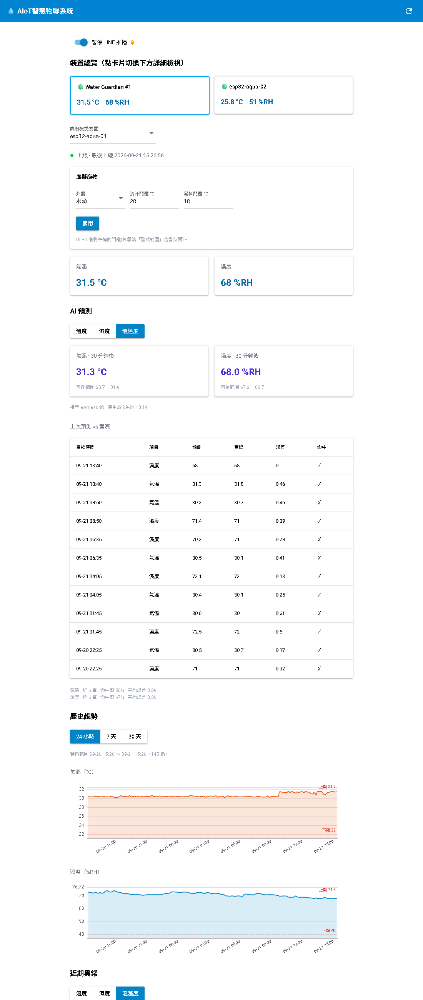
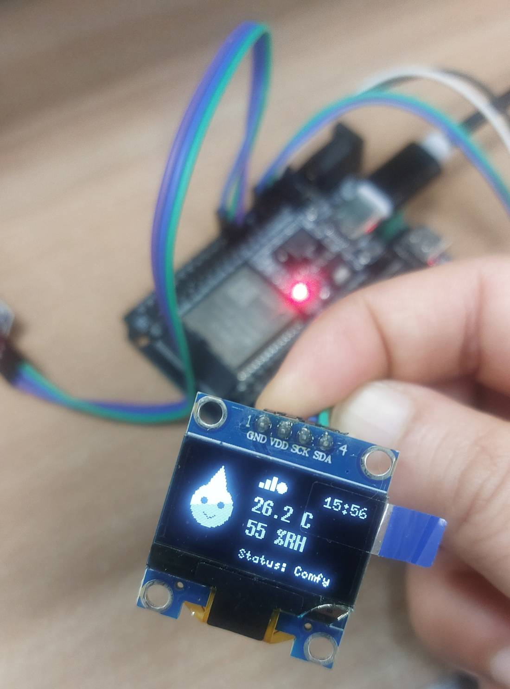
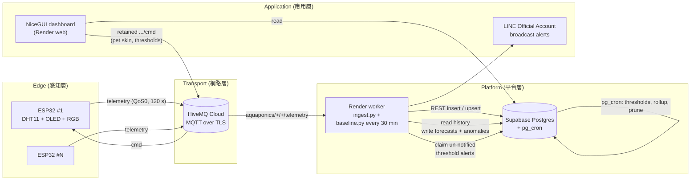

# AIoT智慧物聯系統 — Smart Aquaponics Edge Monitor & AI Predictor

[](https://github.com/Bonny-sun/esp32_1/actions/workflows/ci.yml)

An end-to-end IoT project: ESP32 edge nodes with a pixel-pet OLED UI stream
environment telemetry over MQTT/TLS to a cloud pipeline that stores the
time-series, forecasts the next 30 minutes, detects anomalies, shows everything
on a live dashboard and pushes LINE alerts when a reading leaves its safe band.

**Live dashboard:** https://aquaponics-dashboard-bja1.onrender.com
(NiceGUI on Render, always-on)



<!-- Add your own photos / demo here, e.g.

[Demo video](https://youtu.be/xxxxxxxx)
-->


**Phase 1 (this repo):** air temperature + humidity, OLED pet UI, RGB status
light, MQTT → Supabase, baseline ML, dashboard, LINE alerts, multi-board.
**Phase 2 (planned):** water temperature (DS18B20), pH (DFRobot SEN0161-V2),
soil moisture — the data model and feature pipeline already have slots for them.

## Architecture



MQTT topic contract (`aquaponics/<site>/<device>/…`):

| Topic | Direction | Notes |
|---|---|---|
| `telemetry` | device → cloud | QoS 0, JSON, one packet every 2 min |
| `status` | device → cloud | retained; LWT marks the device offline |
| `cmd` | cloud → device | retained; `{"pet","pet_hot","pet_cold"}` |

## Highlights

- **Non-blocking firmware** — sensor read, animation, LED breathing and MQTT
  each run on their own `millis()` cadence; there is no `delay()` in `loop()`.
- **No secrets in the firmware image** — Wi-Fi (with a backup SSID via
  WiFiMulti), MQTT credentials and the device ID are provisioned at runtime
  through a WiFiManager captive portal and stored in NVS. One firmware image
  serves every board.
- **Multi-board** — every board gets its own `device_id`; the dashboard has a
  per-device overview and the AI job processes every registered device.
- **Wide table + `extra jsonb`** — new sensors can be added by the firmware
  without a schema migration.
- **Server-side alerting** — `pg_cron` checks thresholds every minute and
  writes at most one anomaly per device/metric/hour; the worker claims
  un-notified rows with a single atomic `UPDATE … WHERE notified_at IS NULL`
  so overlapping instances can never push the same alert twice.
- **LINE push** (Messaging API, since LINE Notify was discontinued) with a
  kill switch on the dashboard.
- **Champion-challenger forecasting** — a naive EWMA+drift baseline and a
  gradient-boosted tree (lag/rolling features + time-of-day) run side by
  side every cycle, both landing in `aqua_forecasts` tagged by `model`; the
  dashboard's predicted-vs-actual hit-rate/MAE panel is grouped by
  (metric, model) so the two can be compared on live data instead of
  swapped on faith. Gated rolling z-score and multivariate IsolationForest
  for anomalies.
- **Remote control** — pet skin and the pet's hot/cold expression thresholds
  are set from the dashboard via retained MQTT `cmd`.

## Security

- **Row Level Security on every table** — the `anon` key gets read-only
  `SELECT` policies and no write policy at all; writes (worker, AI job) go
  through `service_role`, which bypasses RLS by design. The dashboard's own
  read-only queries (`load_*` in `dashboard/app.py`) use the `anon` key too
  (`sb_read()`), not `service_role` — so those policies are actually
  enforced on the dashboard's own requests, not just sitting unused. Falls
  back to `service_role` for reads if `SUPABASE_ANON_KEY` isn't set.
- **TLS-verified MQTT everywhere, including the device** — worker and
  dashboard validate HiveMQ's certificate (`ssl.PROTOCOL_TLS_CLIENT`); the
  ESP32 firmware pins ISRG Root X1 (`src/main.cpp`'s
  `HIVEMQ_ROOT_CA`; HiveMQ Cloud's certs are issued by Let's Encrypt) via
  `netClient.setCACert(...)` instead of skipping validation.
- **No raw SQL anywhere** — every DB call goes through Supabase's
  parameterized query builder; there is no string-interpolated SQL in the
  codebase, so there's no SQL-injection surface to begin with.
- **Hashed admin password + brute-force lockout** (`dashboard/auth.py`) —
  `/admin` and `/ask`'s login compares a bcrypt hash
  (`DASH_PASSWORD_HASH`), never a plaintext password. 5 failed attempts
  from the same browser, or 20 site-wide (to catch someone clearing
  cookies to dodge the per-browser cap), locks login out for 15 minutes.
  All three numbers are env-var tunable (`LOGIN_MAX_ATTEMPTS`,
  `LOGIN_SITE_MAX_ATTEMPTS`, `LOGIN_LOCKOUT_SECONDS`).
- **`/ask` rate limiting** — per-visitor and site-wide caps
  (`ASK_RATE_PER_MINUTE` etc.) stop the public Gemini-backed page from
  being hammered.
- **AI agent on a tool whitelist** — the Gemini agent behind `/ask` can
  only call 6 fixed, read-only, argument-validated functions
  (`dashboard/ask/tools.py`); no SQL, no writes, ever reach the model.
- **Dependency scanning** — `.github/dependabot.yml` watches every
  `requirements*.txt` (root, `worker/`, `dashboard/`, `analysis/`) and the
  GitHub Actions used in CI, opening a PR when a dependency has a known
  vulnerability or a newer version.
- **Login history / audit log** (`sql/10_auth_log.sql`) — every `/admin`
  login attempt (success, failed, or blocked by the lockout above) is
  recorded with its timestamp and the attempted username, shown
  as a table at the bottom of `/admin`. `/ask` has no login form by
  default (`ASK_REQUIRE_AUTH=false`) so it has nothing to log in
  practice, but the same logging runs there too if that flag is turned
  on. No IP is stored. Read only via
  `service_role` (`sb()`); the table has RLS enabled with no policy at
  all, so `anon` gets zero rows — an audit log like this is more useful
  to an attacker than to a public reader. 30-day retention via `pg_cron`;
  the UI itself caps at the latest 100 rows.

## AI 問答（Tool Calling）

`/ask` lets a visitor type a question in natural Chinese — "最新溫度是多少?",
"昨天最高溫幾度?", "過去24小時有沒有異常?" — and get an answer sourced from
real data instead of a canned response.

### How it works — Tool Calling, not text-to-SQL

The LLM (Google Gemini, `google-genai` SDK) never sees the database and never
writes SQL. It can only call a fixed set of read-only Python functions
declared up front, each with a strict parameter schema:

```
list_devices()                                      — every registered device
get_latest(device_id=None)                          — most recent reading(s)
get_stats(device_id, metric, hours)                 — ONE avg/max/min summary + when,
                                                        over the whole N-hour window
get_daily_stats(device_id, metric, days)            — avg/max/min + when, ONE entry
                                                        per calendar day, over N days
get_anomalies(device_id=None, hours=None, limit)    — flagged anomalies, optionally
                                                        within the last N hours
get_forecast(device_id)                             — latest forecast per (metric, model)
```

(`hours` up to 720 / `days` up to 30 — a month — matching the dashboard's own
longest history view.)

Text-to-SQL (letting the model write its own queries) is more flexible, but
for a small, fixed data model the flexibility buys little while adding real
risk: a malformed or slow query, or — worse — a write the model wasn't
supposed to make. Tool Calling trades that flexibility for a hard guarantee:
whatever the model asks for, only these read-only functions can run, each
with its own input validation (unknown device → explicit error, not a query
against a nonexistent id; `hours`/`days`/`limit` clamped into a safe range;
`metric` restricted to an allow-list) and output shape (numbers, timestamps,
device names — never a raw DB row or an unbounded block of text). The flow:

```
使用者提問 → Gemini 決定要呼叫哪個/哪些工具 → dashboard 執行工具,查 Supabase
  → 工具結果（純數字/時間，不含任意文字）送回給 Gemini → Gemini 組織成繁體中文回答
  （最多重複 4 輪工具呼叫；超過就回覆「無法完成」，不會無限迴圈）
```

Every answer ends with a one-line "資料來源" note (which tool, which device,
which time range) so it can be checked against the dashboard's own pages.

### Environment variables

| Variable | Required | Notes |
|---|---|---|
| `GEMINI_API_KEY` | to enable the feature | from [Google AI Studio](https://aistudio.google.com/apikey). Unset → `/ask` shows "功能未啟用"; every other page is unaffected. |
| `GEMINI_MODEL` | no | a specific stable model id, e.g. `gemini-3.8-flash`. The Gemini model lineup changes often and old models get shut down — check [the model list](https://ai.google.dev/gemini-api/docs/models) and [deprecations](https://ai.google.dev/gemini-api/docs/deprecations) rather than assuming a name is still current; a "...-latest" rolling alias looked appealing to dodge that, but it broke `/ask` in production once the model it pointed to was shut down (2026-11), so this project now pins a specific stable id instead. Falls back to a code-level default if unset. |
| `ASK_RATE_PER_MINUTE` / `ASK_RATE_PER_DAY` / `ASK_RATE_SITE_PER_DAY` | no | abuse/cost guard: per-visitor and site-wide question caps (sane built-in defaults). In-memory counters — **reset on every restart/redeploy**, which is an accepted tradeoff for a single-instance demo site, not a design for a real multi-tenant product. |
| `ASK_REQUIRE_AUTH` | no | `true` makes `/ask` require the same `DASH_USERNAME`/`DASH_PASSWORD_HASH` login as `/admin`. Defaults to `false` (open), matching this being a public portfolio demo. |

### Local run

```bash
cd dashboard
cp .env.example .env   # fill in SUPABASE_URL/KEY + GEMINI_API_KEY
pip install -r requirements.txt
python app.py
```

Open `http://localhost:8080/ask`.

## Status — live (updated 2026-09-30)

Full pipeline deployed and running 24/7 across two boards.

- **Dashboard pages**, all sharing one top nav bar (首頁/異常警戒/AI預測/
  AI問答/後台設定): `/` — 即時資料總表 (multi-board summary table), live values
  (red when out of band), history charts (10-min bins, dashed 上限/下限
  lines);
  `/forecast` — AI 預測總表 (fleet-wide, latest forecast + aggregate
  hit-rate/error per device+model) above AI預測資料查詢, a per-device 上次
  預測 vs 實際 eval table for both models (champion `ewma+drift` vs
  challenger `gbm`; device + date + model filters, defaults to today);
  `/anomalies` — 異常警戒, a fleet-wide alarm
  list across every device (device + date + metric filters, defaults to
  today), its own page rather than a section so it reads as a
  first-class destination, not something scrolled past;
  `/ask` — AI 問答, a chat page answering natural-language questions about
  the sensor data via LLM Tool Calling (see "AI 問答" section below);
  `/admin` — editable alert thresholds and other settings.
- **Supabase `pg_cron`:** hourly rollup, 30-day raw retention, per-minute
  threshold alerting.
- **AI:** `analysis/baseline.py` runs every 30 min for every device →
  `aqua_forecasts` / `aqua_anomalies`. Lives inside the Render ingest
  worker's own internal timer (`worker/ingest.py`), not a separate
  GitHub Actions schedule — that trigger turned out to be best-effort and
  was silently dropping most ticks; piggybacking on the worker that's
  already running continuously for MQTT costs nothing extra and isn't at
  an external scheduler's mercy.

## Stack

| Layer | Tech |
|---|---|
| Edge | ESP32-WROOM-32, PlatformIO + Arduino (C++), U8g2, non-blocking `millis()` FSM |
| Transport | MQTT over TLS — HiveMQ Cloud (Serverless free) |
| Ingest | Python `paho-mqtt` worker on Render |
| Storage | Supabase (PostgreSQL) — wide table + `extra jsonb`, `pg_cron` |
| AI | pandas + scikit-learn: EWMA+drift & GBM forecast (champion-challenger), rolling z-score → IsolationForest |
| Dashboard | NiceGUI + ECharts on Render |
| AI 問答 | Google Gemini (`google-genai`), manual Tool Calling against read-only query functions |
| Alerts | LINE Messaging API |
| Scheduling | internal timer inside the Render ingest worker (no external cron) |

See [`docs/architecture.md`](docs/architecture.md) for the full design, wiring
tables, JSON schema, decisions log and deployment runbook.

## Hardware & wiring

| Part | Pin |
|---|---|
| DHT11 data | GPIO 4 |
| SSD1306 OLED (I²C) | SDA GPIO 21, SCL GPIO 22 |
| RGB LED (220 Ω each, LEDC PWM) | R GPIO 16, G GPIO 17, B GPIO 18 |
| BOOT button | GPIO 0 — hold 3 s after power-on to open the Wi-Fi portal |

## Repo layout

```
platformio.ini             PlatformIO project + pinned libs
include/secrets.h.example  copy -> include/secrets.h (gitignored)
src/main.cpp               firmware: sensor + pet animation + Wi-Fi/MQTT FSM
sql/                       Supabase DDL + migrations (run in order in the SQL editor)
worker/ingest.py           Render background worker: MQTT -> Supabase + LINE push,
                           also runs analysis/baseline.py on its own 30-min timer
dashboard/app.py           NiceGUI dashboard (Render web service)
dashboard/ask/             AI 問答: LLM Tool Calling agent + read-only query tools
analysis/baseline.py       pull history -> forecast + anomalies -> write back
                           (imported directly by worker/ingest.py in production;
                           still runnable standalone for local testing)
render.yaml                Render Blueprint (worker + dashboard)
.github/workflows/         CI (lint+test+firmware build) + a manual-only
                           forecast.yml for testing baseline.py by hand
tests/                     pytest suite (worker, analysis, ask; Supabase/LLM faked)
requirements-dev.txt       deps for lint + tests
tools/png_to_xbm.py        convert a 48x48 1-bit PNG to a C XBM array (optional)
docs/architecture.md       design doc + decisions log
```

## Quick start

### 1. Firmware
```bash
cp include/secrets.h.example include/secrets.h   # fill in defaults
pio run -t upload && pio device monitor
```
Expected: OLED shows the pet + live T/H, RGB breathes green, serial prints
`[MQTT] publish OK ... /telemetry` every 120 s. On first boot (or hold BOOT for
3 s after reset) join the `AquaGuardian-Setup` Wi-Fi to enter Wi-Fi, MQTT and
device ID.

### 2. Database
Supabase SQL editor → run `sql/schema.sql`, then `02`…`07` in order. Enable
`pg_cron` under *Database → Extensions*.

### 3. Ingest worker + dashboard
Push to GitHub → Render **New + → Blueprint** → set the `sync: false` env
vars (MQTT + Supabase secrets, optional `LINE_CHANNEL_TOKEN`) → deploy. The
worker also starts forecasting on its own 30-min timer once there's ~1 day
of data — no separate AI job to deploy.

### 4. AI baseline (optional, local testing only)
```bash
cd analysis
cp .env.example .env         # SUPABASE_URL + service_role key
pip install -r requirements.txt
python baseline.py           # after ~1 day of data
```

### Tests
```bash
pip install -r requirements-dev.txt
ruff check .
pytest -q
```
CI (`.github/workflows/ci.yml`) runs the same two commands plus a
`pio run` firmware build on every push and pull request.

## Firmware behaviour

| Condition | Pet | RGB LED |
|---|---|---|
| between cold and hot thresholds (default 18–28 °C) | blinking / breathing | green, breathing |
| above hot threshold (hysteresis 1 °C) | dizzy eyes + sweat drip | red, breathing |
| below cold threshold | shivering + chattering | blue, breathing |
| Wi-Fi down | — | amber |
| MQTT publish | — | cyan blip (200 ms) |

## Roadmap

- [ ] Phase 2 sensors (water temp / pH / soil) — fill the reserved pins and
      the `null` metric slots; add columns to `FEATURE_COLS`
- [x] NiceGUI dashboard on Render reading Supabase
- [x] Remote pet / threshold config via `aquaponics/<site>/<device>/cmd`
- [x] LINE alerts, multi-board support
- [x] Tests + CI (pytest, ruff, firmware build on every push)
- [ ] Per-device MQTT credentials with topic-level ACLs
- [ ] Device-offline alert, OTA firmware updates
- [ ] Prophet / LightGBM model once multivariate history exists
